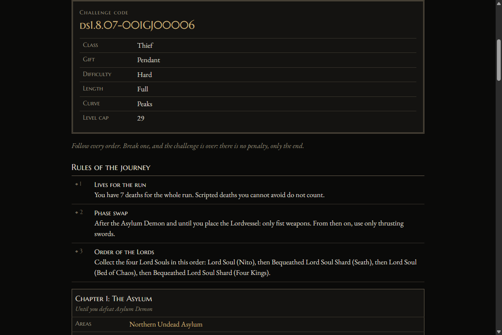

# darksouls-challenge

A challenge generator for Dark Souls: Remastered. It does not modify the game: it hands you a manual of orders, self-imposed rules
told in the voice of a game master, and guarantees that every challenge it generates is possible to finish.



## How it works

- **Orders** are the rules of a challenge ("never use a shield", "Gravelord Nito before the second bell").
- Every order is checked against a model of the game: the progression graph, item locations, bosses, merchants and equipment. A
  challenge that cannot be finished is never generated.
- A **challenge code** such as `ds1.8.07-K39ZA00001` holds the game, both versions and every setting. Same code, same challenge, on
  any machine.
- Players can sign in and record the challenges they finish on a ranking. A run is the player's own word.

## Stack

Java 21, Spring Boot 4 (MVC, Security with JWT, Data JPA, Actuator), PostgreSQL, Flyway, Angular 22, JUnit, Testcontainers, Selenium,
GitHub Actions and Cloudflare Containers.

| Path        | What                                                 |
| ----------- | ---------------------------------------------------- |
| `core/`     | The domain in plain Java: graph, validator, generator |
| `cli/`      | Generates a challenge from the command line          |
| `server/`   | REST API and host of the site, on PostgreSQL         |
| `web/`      | The site, in Angular                                 |
| `data/ds1/` | The data set and its schema (`SCHEMA.md`)            |
| `deploy/`   | The Worker that runs the image on Cloudflare         |
| `docs/adr/` | Architecture decision records                        |

A few decisions worth a look:

- **Generated jobs are rows, not messages.** A worker takes each one with `FOR UPDATE SKIP LOCKED` inside a transaction as long as the
  work: if the process dies, the lock goes with it and the job is simply taken again ([ADR 0014](docs/adr/0014-server.md)).
- **Determinism is tested, not assumed.** Hashes of 200 manuals and 67 whole manuals, across every length, curve and group setting, are
  checked byte for byte against reference files ([ADR 0016](docs/adr/0016-java.md)).
- **The domain knows no framework.** `core` depends only on Jackson, and the server and the CLI are thin layers around it.

## Development

Requires JDK 21 and Node 24. Nothing else: the tests use Testcontainers when Docker is there, as in CI, and otherwise start a real PostgreSQL
from binaries in their own dependencies.

```sh
./mvnw test                     # the core and the API
cd web && npm ci && npx ng build && cd ..
TEST_BROWSER=1 ./mvnw test      # also the whole site, in Chrome
```

```sh
# A challenge on the command line
./mvnw -pl cli -am -DskipTests package
java -jar cli/target/darksouls-challenge.jar --difficulty hard --length short

# The server, with the built site inside it
./mvnw -pl server -am -DskipTests package
JWT_SECRET=<at least 32 bytes> SPRING_DATASOURCE_URL=jdbc:postgresql://localhost:5432/darksouls_challenge \
  java -jar server/target/darksouls-server.jar

# The site with live reload, against that server
cd web && npx ng serve
```

The server refuses to start without `JWT_SECRET`: tokens signed with a key anyone can read would be no tokens at all. The `Dockerfile`
builds the site and the server into one image. Health and Prometheus metrics answer on port 8081, which the public never reaches, and
`./mvnw spotless:apply` tidies the imports and whitespace CI checks.

## Deploying

The `Deploy` workflow runs by hand, from the Actions tab, and needs these repository secrets: `CLOUDFLARE_API_TOKEN`, `CLOUDFLARE_ACCOUNT_ID`,
`JWT_SECRET`, `DATABASE_URL` (JDBC), `DATABASE_USERNAME` and `DATABASE_PASSWORD`. See [ADR 0018](docs/adr/0018-hosting.md).

See [CONTRIBUTING.md](CONTRIBUTING.md) for the workflow, [CODE_OF_CONDUCT.md](CODE_OF_CONDUCT.md) and [SECURITY.md](SECURITY.md).

## Licenses

- Code: [MIT](LICENSE).
- Data (`data/`): [CC BY-SA 4.0](data/LICENSE), with attribution in [`data/README.md`](data/README.md).

## Disclaimer

Not affiliated with or endorsed by FromSoftware or Bandai Namco. Dark Souls is a trademark of its owners. This repository contains no
game files or game text; only facts about the game (IDs, names, numbers).
