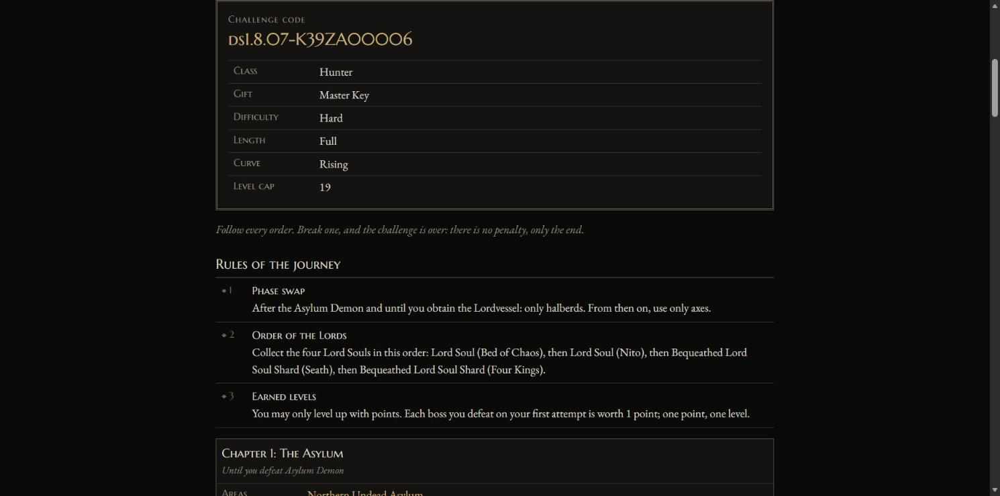

# darksouls-challenge

A challenge generator for Dark Souls: Remastered. It does not modify the game: it hands you a manual of orders,
self-imposed rules told in the voice of a game master, and guarantees that every challenge it generates is possible
to finish.



## How it works

- **Orders** are the rules of a challenge ("never use a shield", "Gravelord Nito before the second bell").
- Every order is checked against a model of the game: the progression graph, item locations, bosses, merchants and
  equipment. A challenge that cannot be finished is never generated.
- A **challenge code** such as `ds1.8.07-K3F9QX2M7T` holds the game, both versions and every setting. Same code, same
  challenge, on any machine: the same C# core runs on the server, the command line and in the browser.
- Players can sign in and record the challenges they finish on a ranking. A run is the player's own word.

## Repository layout

| Path                             | What                                                 |
| -------------------------------- | ---------------------------------------------------- |
| `data/ds1/`                      | The data set and its schema (`SCHEMA.md`)            |
| `src/DarkSoulsChallenge.Core/`   | Domain core in pure C#: graph, validator, generator  |
| `src/DarkSoulsChallenge.Cli/`    | Generates a challenge from the command line          |
| `src/DarkSoulsChallenge.Web/`    | The site, in Blazor WebAssembly                      |
| `src/DarkSoulsChallenge.Server/` | ASP.NET Core API and host of the site, on PostgreSQL |
| `tests/`                         | Unit, integration and browser tests                  |
| `docs/adr/`                      | Architecture decision records                        |

## Development

Requires the .NET 10 SDK (see `global.json`).

```sh
dotnet build
dotnet test
dotnet format --verify-no-changes
```

The server tests need a PostgreSQL where they can create a database, given in `TEST_POSTGRES`. The browser tests also need
Chrome, and run with `TEST_BROWSER=1`. CI runs both.

```sh
# A challenge on the command line
dotnet run --project src/DarkSoulsChallenge.Cli -- --difficulty hard --length short

# The site alone: generating needs no server, accounts and the ranking do
dotnet run --project src/DarkSoulsChallenge.Web

# Everything, with the connection string in ConnectionStrings__Default
dotnet run --project src/DarkSoulsChallenge.Server
```

Publish with ahead-of-time compilation, which needs `dotnet workload install wasm-tools`. Without it a long challenge takes
many seconds in the browser, instead of under one.

```sh
dotnet publish src/DarkSoulsChallenge.Server -c Release -p:RunAOTCompilation=true
```

See [CONTRIBUTING.md](CONTRIBUTING.md) for the workflow, [CODE_OF_CONDUCT.md](CODE_OF_CONDUCT.md) and
[SECURITY.md](SECURITY.md).

## Licenses

- Code: [MIT](LICENSE).
- Data (`data/`): [CC BY-SA 4.0](data/LICENSE), with attribution in [`data/README.md`](data/README.md).

## Disclaimer

Not affiliated with or endorsed by FromSoftware or Bandai Namco. Dark Souls is a trademark of its owners. This
repository contains no game files or game text; only facts about the game (IDs, names, numbers).
